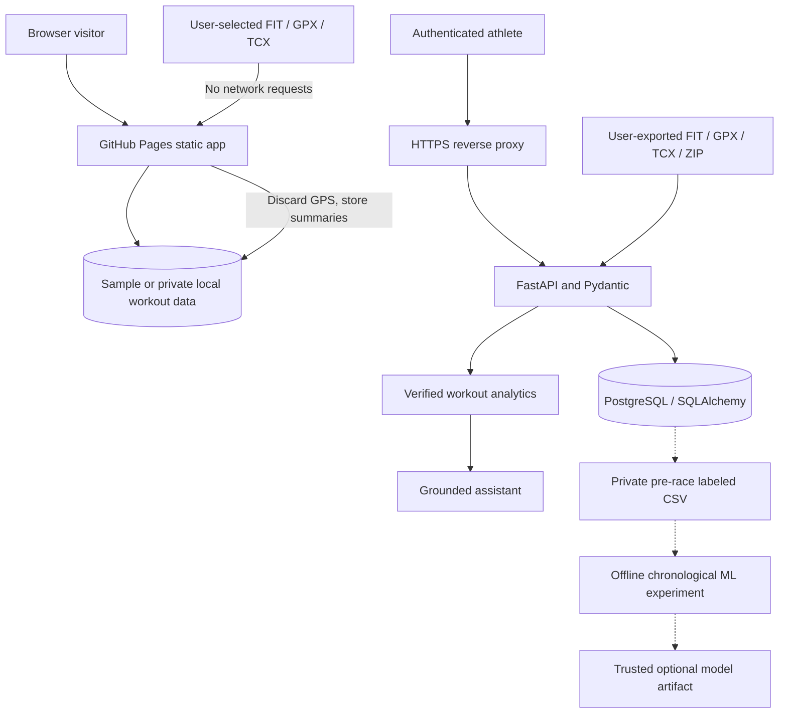

# PaceLab — Running Intelligence

### [▶ Open the live PaceLab demo](https://dokeefe414.github.io/Pacelab/) · [Architecture](docs/architecture.md) · [Project case study](docs/case-study.md)

**Explore running analytics directly in your browser — no installation or
account required.** PaceLab starts with fictional demo workouts, but v0.8
also lets you privately import real FIT/GPX/TCX exports and analyze them
without uploading your data to a server. Raw GPS coordinates are discarded
before browser-local storage.

PaceLab is an open-source software-engineering and machine-learning project
by **Daniel O'Keefe**, combining collegiate distance-running interests
with full-stack APIs, wearable activity data, interactive analytics,
test automation and responsible prediction research.

> **Current status: v0.9 Athlete Studio.** The browser site supports
> real local FIT/GPX/TCX imports, deeper workout telemetry, monthly/weekly
> analysis, race history and private backups. All of this works without
> installing software or creating an account. **No cloud account API has
> been deployed**; Render still requires owner approval, hosting costs,
> security controls and verified deployment. ML remains experimental.
> A new **Research Track 1** is testing adaptation to *synthetic* shifts;
> these experiments do not validate predictions for actual runners.

## Our central research goal

**PaceLab should help runners understand training development and,
eventually, deliver trustworthy race forecasts under changing conditions.**
The application is where runners explore their records; the research is
where we test whether prediction methods actually work.

Our new [Distribution-Shift Research Track](docs/distribution-shift-study.md)
tests a naive previous-race baseline alongside frozen, periodically updated,
rolling-window and observed-error-triggered models under controlled shifts. Every forecast is generated
**before** the result is revealed, and each experiment has reproducible
seeds, baselines, negative controls and openly documented limitations.

**Research results are not yet real-athlete prediction results.** We will
only consider putting adaptive machine learning into the public race
predictor after genuine labeled races demonstrate reliable held-out
performance and honest uncertainty.

## Try it in under a minute

1. **[Launch the website](https://dokeefe414.github.io/Pacelab/)**.
2. Explore the **Overview** and **Insights** dashboards. All demo
   activity data is synthetic, not a real person's location or results.
3. Open **Workout log → FIT / GPX / TCX** and choose an exported running
   file. Review the privacy warning, then import it entirely in-browser.
4. Open an imported workout's **Details**, switch between recorded sensor
   charts, and explore the distance-aware Lap Lab. If it was a race,
   change its type to **Race** and save.
5. Visit **Insights → Athlete Studio** to view monthly mileage and fair
   completed-week comparisons. Switch the plot to Easy/Recovery pace.
6. Visit **Race predictor** to view a recent-race formula estimate or
   check your real race-data readiness and export pre-race research rows.
7. Ask the **Training assistant** about mileage, pace or recorded races.
8. Use **Backup local data** to protect your browser-stored training log.

Nothing in the local import flow is uploaded to PaceLab's servers.
The browser saves workout and sensor summaries; **not** original file
bytes or GPS coordinates. Backups are not encrypted by PaceLab, and
clearing site storage can erase local data. Read the
[privacy-first import guide](docs/browser-import.md) for exact limits.
The full authenticated multi-device system still needs separate HTTPS hosting.

## Product features

| Experience | What it does | Available in Pages demo? |
|---|---|---|
| Running dashboard | Weekly mileage, training duration and training mix | Yes |
| Athlete Studio | Monthly mileage, equal completed-week comparisons, easy pace, lap lab, sensor explorer and race progression | **Yes, interactive browser analytics** |
| Workout log | Import, edit, classify, filter and compare exported real runs | Yes, local storage |
| Race equivalent | Riegel conversion between 800m, mile, 3K, 5K, 8K and 10K | Yes, mathematical baseline |
| Grounded assistant | Data-grounded statistics with optional per-question AI opt-in | Yes, deterministic local mode |
| Wearable coverage | Shows recorded HR, cadence, power and elevation versus missing data | Yes |
| Private accounts | User-scoped storage, password changes and session revocation across devices | Requires separate API |
| COROS import | Browser-local FIT/GPX/TCX with no GPS saved; private server supports ZIP and reduced GPS | **Yes** for single files; ZIP requires API |
| Athlete privacy controls | Local full JSON backup/restore and no-GPS browser storage; private account export/deletion via API | **Yes** for local backups |
| Research ML predictor | Local labeled-race readiness and CSV export; model training requires genuine data and a trusted backend | **Yes** for local preparation, not model inference |
| HTTPS production reference | FastAPI, Postgres, Nginx, Caddy, Docker and backups | Requires operator-owned server |

### Performance and wearable insights

When data is available, PaceLab distinguishes **timer/moving** duration from
**elapsed** duration; it retains recorded device laps, heart-rate samples,
cadence, running power and elevation changes. Workout plots label
missing sensor information honestly. Its fixed HR bands and weighted
training minutes are descriptive only, **not** individualized physiological
zones, fatigue scores or medical advice.

Race progression includes actual **Race-labeled** workouts close to the
selected event distance. A fictional sample log without races does not
fabricate personal records. **Athlete Studio** plots only recorded sensor
data, separates short recovery-size laps, and excludes partial weeks
from the equal-length four-week comparison. See
[the v0.9 Athlete Studio technical guide](docs/athlete-studio.md).

## Engineering architecture



**Public and private modes are deliberately separated.** The static
site now processes real exports inside the browser without sending them
to a server. GitHub Pages still cannot run PostgreSQL or FastAPI, and
PaceLab never silently collects a private route in this local mode.

[Full architecture and trust boundaries](docs/architecture.md)

## Technology stack

| Area | Tools and concepts |
|---|---|
| Frontend | JavaScript ES modules, HTML/CSS, Vite, accessible responsive UI |
| API | Python, FastAPI, Pydantic, authenticated REST endpoints |
| Database | PostgreSQL / SQLite for local dev, SQLAlchemy, Alembic migrations |
| Sport data | Client-side FIT/GPX/TCX, server-side bounded ZIP, invalid-sensor filtering and duplicate detection |
| Modeling | scikit-learn: median, ridge, random forest, gradient boosting, compact neural network |
| Research evaluation | Chronological holdouts, expanding-window backtests, MAE/RMSE, intervals and model cards |
| Infrastructure | Docker Compose, Nginx, Caddy HTTPS reverse proxy |
| QA | Node tests, pytest, Playwright Chromium E2E and GitHub Actions |

## Optional cloud-hosted private backend

The repository includes an [opt-in Render Blueprint](render.yaml) and
[step-by-step managed PostgreSQL deployment guide](docs/render-deployment.md).
**Adding these files does not create a server or start billing.** A Render
account owner must connect the service, review ongoing costs, approve
deployment, provision private users and verify security before collecting
running data. Public account signup stays disabled by default.

## Run the full application locally

The public **[browser demo](https://dokeefe414.github.io/Pacelab/)**
requires no setup. To run the **private backend**, install Docker Desktop,
then use PowerShell:

```powershell
git clone https://github.com/dokeefe414/Pacelab.git
cd Pacelab
Copy-Item .env.example .env
notepad .env
```

Replace the placeholder database password and signing key with
**independent secure random values**. Keep the file private, then run:

```powershell
docker compose up --build
```

Open **http://localhost:8080**. The API and PostgreSQL are connected
internally in Docker. You can sign in, upload your own exported activity
files and use private account features.

For an HTTPS private beta on a server **you control**, follow the
[full self-hosting runbook](deploy/README.md) and
[security prerequisites](SECURITY.md). A successful GitHub Pages build
does **not** deploy your private backend.

## COROS workout imports

The self-hosted backend supports individual **FIT, GPX and TCX** files and
ZIP exports containing up to 100 supported activities within the documented
compression and size limits. Original binary files are parsed in memory
and discarded; a bounded set of derived GPS coordinates can still be
stored in your **private account**, and can reveal sensitive locations.

The browser FIT decoder was locally checked with four private running
FIT files, including activities containing elapsed-time pauses, without
committing the files or publishing routes. Synthetic binary FIT and
browser import fixtures run in CI. The original private activity
files and GPS traces are **not included** in GitHub.
Read the [browser import specification](docs/browser-import.md),
[tests](docs/testing.md) and
[architecture](docs/architecture.md) for exact capabilities and limitations.

## Data readiness and consent

The local browser and authenticated Race predictor can check how many
genuine labeled pre-race rows and distinct race dates are available before
an experimental model is trained. A minimum of **60 rows and 12 dates** is only a research
preflight, not evidence of useful race predictions.

Optional multi-athlete experiments accept a **pseudonymous** athlete_id
column for athlete-disjoint validation; no athlete identities or routes
appear in the metrics. [Read the research data guide](docs/race-data-governance.md).

The private-server COROS importer requires explicit GPS-storage
acknowledgment. Browser-local imports require separate **device storage**
consent, but discard GPS and raw source bytes. Even when an external
AI provider is configured, transmitting the question and aggregate
stats requires **opt-in on that individual question**.

## AI and model evaluation: what is real

**Formula baseline:** The public race calculator implements

```text
T(target) = T(reference) × (D(target) / D(reference)) ^ 1.06
```

It is an interpretable race equivalent, not a model trained on runner data.

**Offline ML research:** After obtaining permissioned, genuine recorded
race results, a logged-in user can export a race-training CSV. Each label
uses training features from the **28 days strictly before** the race,
never workouts after that date. The experimental pipeline compares
multiple baselines and records date-held-out errors and limitations.

**No fabricated validation:** The project has synthetic test fixtures for
code correctness, but it does not claim a trained race model improves
accuracy on a representative genuine cohort. A valid real-world model
requires sufficient data, athlete-disjoint evaluation where appropriate,
and results on future races.

Read the [ML methodology and limitations](docs/ml-methodology.md).

## Run automated tests

From the repository root:

```bash
npm install
npm test
npm run build
npx playwright install chromium
npm run test:e2e
```

From the backend/ directory:

```bash
python -m pip install -r requirements-dev.txt
python -m pytest -q
alembic upgrade head
```

All workflows appear under
[GitHub Actions](https://github.com/dokeefe414/Pacelab/actions).
Unit tests, a synthetic FIT/API roundtrip, database checks and browser
regressions run without leaking personal watch data.

## Documentation

Start with the [documentation index](docs/README.md).

| Guide | What you'll learn |
|---|---|
| [System architecture](docs/architecture.md) | Component diagram, DB model, ownership, privacy boundaries |
| [Privacy-first browser imports](docs/browser-import.md) | FIT/GPX/TCX parsing, local sensor storage, backup and privacy limits |
| [Athlete Studio v0.9](docs/athlete-studio.md) | Monthly/weekly analytics, interactive sensors, lap rules and accessibility |
| [Production beta checklist](docs/production-beta-checklist.md) | Cloud, privacy, monitoring, backup and research sign-off gates |
| [REST API reference](docs/api.md) | Routes, auth, payloads, errors and data units |
| [Testing & CI](docs/testing.md) | Frontend, browser, backend, FIT and database tests |
| [ML methodology](docs/ml-methodology.md) | Features, leakage control, baselines and uncertainty |
| [Controlled shift research](docs/distribution-shift-study.md) | Rigorous synthetic shift/forecasting protocol and reproducible experiment |
| [Engineering decisions](docs/decisions.md) | Design choices and honest tradeoffs |
| [Portfolio case study](docs/case-study.md) | Problem, architecture and interview walkthrough |
| [Self-hosted deployment](deploy/README.md) | HTTPS, operator setup, diagnostics, backups and rollback |
| [Optional Render hosting](docs/render-deployment.md) | Cloud Blueprint, costs, private account provisioning, verification |
| [Privacy & operations](docs/privacy-and-operations.md) | Protecting athlete data, deletion and backups |
| [Security policy](SECURITY.md) | Responsible reporting and public-release prerequisites |
| [Contributing](CONTRIBUTING.md) | Developer setup and pull-request expectations |
| [Changelog](CHANGELOG.md) | Release history |

## Current boundaries and roadmap

- **Available now:** Public no-installation site with real, privacy-first
  FIT/GPX/TCX analysis, Athlete Studio's monthly and completed-week
  trends, interactive sensor and lap exploration, local race research
  and private JSON backups.
  The authenticated backend source code and its research tools are tested.
- **Not yet live:** Public account/database service, automatic provider
  synchronization and a validated personalized ML forecast.
- **Before public accounts:** Centralized rate limits, stronger session
  revocation/recovery, explicit privacy consent, incident response,
  encrypted scheduled backups and an independent security review.
- **Research Track 1:** Synthetic stationary, covariate, relationship,
  noise and combined shifts; four updating policies, paired seeds,
  causal forecast-before-result testing and explicit detector alarms.
- **Next real-data step:** More preregistered stress-test scenarios,
  delayed/sparse race labels and genuinely consented cohorts with
  chronological and athlete-disjoint holdouts. Synthetic error reductions
  are not evidence of actual forecasting accuracy.

**Built by Daniel O'Keefe** · [Live sample-data demo](https://dokeefe414.github.io/Pacelab/) ·
[Source repository](https://github.com/dokeefe414/Pacelab)
