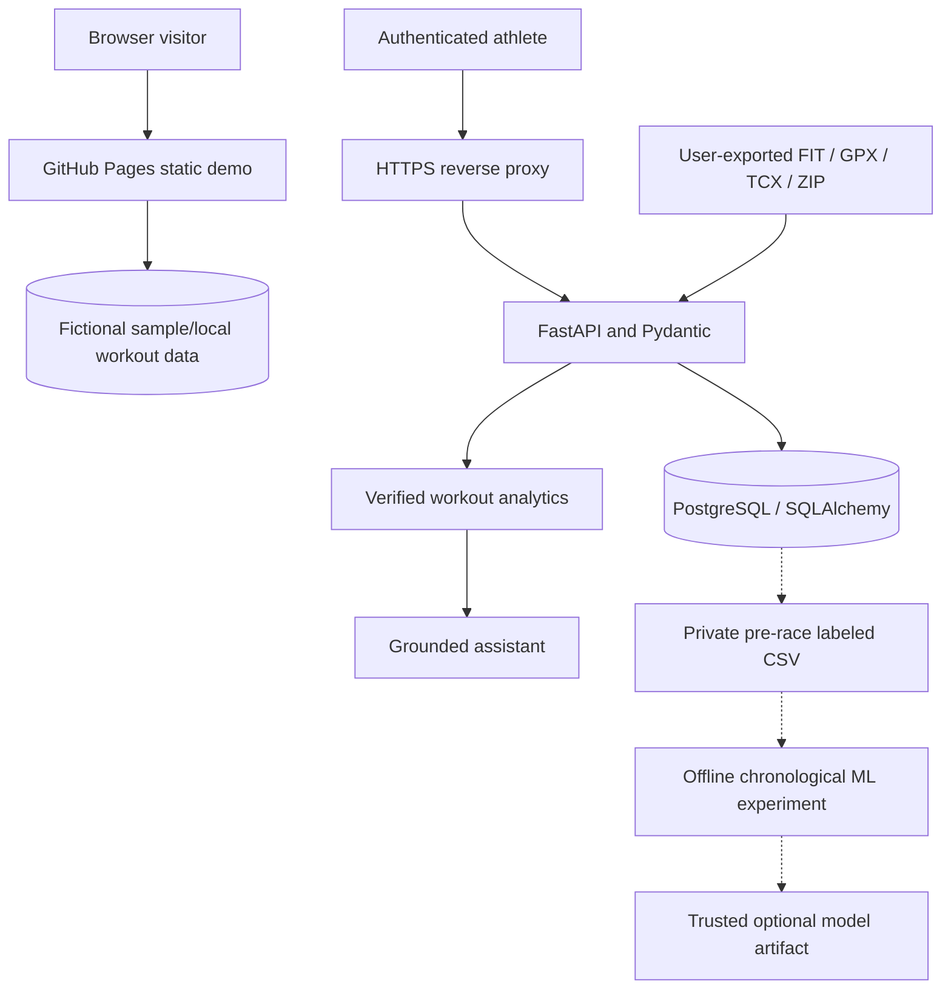

# PaceLab — Running Intelligence

### [▶ Open the live PaceLab demo](https://dokeefe414.github.io/Pacelab/) · [Architecture](docs/architecture.md) · [Project case study](docs/case-study.md)

**Explore a running analytics product directly in your browser — no downloads,
account or installation required.** The public demo has clearly labeled
fictional training data, so employers can explore its functionality without
access to a runner's private information.

PaceLab is an open-source software-engineering and machine-learning project
by **Daniel O'Keefe**, combining collegiate distance-running interests
with full-stack APIs, wearable activity data, interactive analytics,
test automation and responsible prediction research.

> **Current status: v0.7 private-beta engineering source.** The GitHub
> Pages demo is live. The authenticated API requires separate hosting.
> An optional Render Blueprint is ready to review, but **no cloud resources
> have been activated or verified live**. Race ML is exploratory rather
> than a validated personalized forecast.

## Try it in under a minute

1. **[Launch the website](https://dokeefe414.github.io/Pacelab/)**.
2. Explore the **Overview** and **Insights** dashboards. All demo
   activity data is synthetic, not a real person's location or results.
3. Open **Workout log** to compare, filter and manually log activities.
4. Visit **Race predictor** to see the transparent Riegel formula.
5. Ask the **Training assistant** about logged mileage, pace or race bests;
   the browser-only mode calculates answers locally from the current log.

The public preview can save manually entered data **in that browser**.
It does not host accounts, server imports or private records. The
private-beta account experience requires a separately deployed HTTPS API.

## Product features

| Experience | What it does | Available in Pages demo? |
|---|---|---|
| Running dashboard | Weekly mileage, training duration and training mix | Yes |
| Athlete performance center | 12-week activity calendar, workout comparisons, event-specific race progression | Yes |
| Workout log | Add, edit, filter, export and compare manual activities | Yes, local storage |
| Race equivalent | Riegel conversion between 800m, mile, 3K, 5K, 8K and 10K | Yes, mathematical baseline |
| Grounded assistant | Data-grounded statistics with optional per-question AI opt-in | Yes, deterministic local mode |
| Wearable coverage | Shows recorded HR, cadence, power and elevation versus missing data | Yes |
| Private accounts | User-scoped storage, password changes and session revocation across devices | Requires separate API |
| COROS import | FIT/GPX/TCX or ZIP, with an explicit private-GPS-storage acknowledgement | Requires separate API |
| Athlete privacy controls | Full JSON export and password-confirmed account deletion | Requires separate API |
| Research ML predictor | Real labeled-race readiness and optional athlete-disjoint evaluation | Requires genuine data, trusted model and API |
| HTTPS production reference | FastAPI, Postgres, Nginx, Caddy, Docker and backups | Requires operator-owned server |

### Performance and wearable insights

When data is available, PaceLab distinguishes **timer/moving** duration from
**elapsed** duration; it retains recorded device laps, heart-rate samples,
cadence, running power and elevation changes. Workout plots label
missing sensor information honestly. Its fixed HR bands and weighted
training minutes are descriptive only, **not** individualized physiological
zones, fatigue scores or medical advice.

Race progression includes actual **Race-labeled** workouts close to the
selected event distance. A fictional sample log without races does not
fabricate personal records.

## Engineering architecture



**Public and private modes are deliberately separated.** GitHub Pages
cannot run PostgreSQL or a Python API. We do not silently collect private
GPS traces in the sample-data demo.

[Full architecture and trust boundaries](docs/architecture.md)

## Technology stack

| Area | Tools and concepts |
|---|---|
| Frontend | JavaScript ES modules, HTML/CSS, Vite, accessible responsive UI |
| API | Python, FastAPI, Pydantic, authenticated REST endpoints |
| Database | PostgreSQL / SQLite for local dev, SQLAlchemy, Alembic migrations |
| Sport data | FIT, GPX and TCX parsing, bounded ZIP imports and duplicate detection |
| Modeling | scikit-learn: median, ridge, random forest, gradient boosting, compact neural network |
| Research evaluation | Chronological holdouts, expanding-window backtests, MAE/RMSE, intervals and model cards |
| Infrastructure | Docker Compose, Nginx, Caddy HTTPS reverse proxy |
| QA | Node tests, pytest, Playwright Chromium E2E and GitHub Actions |

## Optional cloud-hosted private backend

The repository includes an [opt-in Render Blueprint](render.yaml) and
[step-by-step managed PostgreSQL deployment guide](docs/render-deployment.md).
**Adding these files does not create a server or start billing.** A Render
account owner must connect the service, review ongoing costs, approve
deployment, provision private users and verify security before collecting
running data. Public account signup stays disabled by default.

## Run the full application locally

The public **[browser demo](https://dokeefe414.github.io/Pacelab/)**
requires no setup. To run the **private backend**, install Docker Desktop,
then use PowerShell:

```powershell
git clone https://github.com/dokeefe414/Pacelab.git
cd Pacelab
Copy-Item .env.example .env
notepad .env
```

Replace the placeholder database password and signing key with
**independent secure random values**. Keep the file private, then run:

```powershell
docker compose up --build
```

Open **http://localhost:8080**. The API and PostgreSQL are connected
internally in Docker. You can sign in, upload your own exported activity
files and use private account features.

For an HTTPS private beta on a server **you control**, follow the
[full self-hosting runbook](deploy/README.md) and
[security prerequisites](SECURITY.md). A successful GitHub Pages build
does **not** deploy your private backend.

## COROS workout imports

The self-hosted backend supports individual **FIT, GPX and TCX** files and
ZIP exports containing up to 100 supported activities within the documented
compression and size limits. Original binary files are parsed in memory
and discarded; a bounded set of derived GPS coordinates can still be
stored in your **private account**, and can reveal sensitive locations.

The importer has been inspected against private COROS activity exports
and tested against synthetic binary FIT inputs. The original private
activity files and routes are **not included** in the repository.
See [tests](docs/testing.md) and
[architecture](docs/architecture.md) for parser guarantees and caveats.

## Data readiness and consent

The authenticated Race predictor can check how many genuine labeled
pre-race rows and distinct race dates are available, before an experimental
model is trained. A minimum of **60 rows and 12 dates** is only a research
preflight, not evidence of useful race predictions.

Optional multi-athlete experiments accept a **pseudonymous** athlete_id
column for athlete-disjoint validation; no athlete identities or routes
appear in the metrics. [Read the research data guide](docs/race-data-governance.md).

The private COROS importer requires explicit GPS-storage acknowledgment.
Even when an external AI provider is configured, sending a question and
aggregate stats requires **opt-in on that individual question**.

## AI and model evaluation: what is real

**Formula baseline:** The public race calculator implements

```text
T(target) = T(reference) × (D(target) / D(reference)) ^ 1.06
```

It is an interpretable race equivalent, not a model trained on runner data.

**Offline ML research:** After obtaining permissioned, genuine recorded
race results, a logged-in user can export a race-training CSV. Each label
uses training features from the **28 days strictly before** the race,
never workouts after that date. The experimental pipeline compares
multiple baselines and records date-held-out errors and limitations.

**No fabricated validation:** The project has synthetic test fixtures for
code correctness, but it does not claim a trained race model improves
accuracy on a representative genuine cohort. A valid real-world model
requires sufficient data, athlete-disjoint evaluation where appropriate,
and results on future races.

Read the [ML methodology and limitations](docs/ml-methodology.md).

## Run automated tests

From the repository root:

```bash
npm install
npm test
npm run build
npx playwright install chromium
npm run test:e2e
```

From the backend/ directory:

```bash
python -m pip install -r requirements-dev.txt
python -m pytest -q
alembic upgrade head
```

All workflows appear under
[GitHub Actions](https://github.com/dokeefe414/Pacelab/actions).
Unit tests, a synthetic FIT/API roundtrip, database checks and browser
regressions run without leaking personal watch data.

## Documentation

Start with the [documentation index](docs/README.md).

| Guide | What you'll learn |
|---|---|
| [System architecture](docs/architecture.md) | Component diagram, DB model, ownership, privacy boundaries |
| [REST API reference](docs/api.md) | Routes, auth, payloads, errors and data units |
| [Testing & CI](docs/testing.md) | Frontend, browser, backend, FIT and database tests |
| [ML methodology](docs/ml-methodology.md) | Features, leakage control, baselines and uncertainty |
| [Engineering decisions](docs/decisions.md) | Design choices and honest tradeoffs |
| [Portfolio case study](docs/case-study.md) | Problem, architecture and interview walkthrough |
| [Self-hosted deployment](deploy/README.md) | HTTPS, operator setup, diagnostics, backups and rollback |
| [Optional Render hosting](docs/render-deployment.md) | Cloud Blueprint, costs, private account provisioning, verification |
| [Privacy & operations](docs/privacy-and-operations.md) | Protecting athlete data, deletion and backups |
| [Security policy](SECURITY.md) | Responsible reporting and public-release prerequisites |
| [Contributing](CONTRIBUTING.md) | Developer setup and pull-request expectations |
| [Changelog](CHANGELOG.md) | Release history |

## Current boundaries and roadmap

- **Available now:** Public synthetic demo, browser-local analytics,
  private-backend source code, COROS file processing and tested research tools.
- **Not yet live:** Public account/database service, automatic provider
  synchronization and a validated personalized ML forecast.
- **Before public accounts:** Centralized rate limits, stronger session
  revocation/recovery, explicit privacy consent, incident response,
  encrypted scheduled backups and an independent security review.
- **Next research step:** Evaluate true chronological and athlete-disjoint
  accuracy using consented labeled races. Never confuse an attractive
  prediction plot with a trustworthy model.

**Built by Daniel O'Keefe** · [Live sample-data demo](https://dokeefe414.github.io/Pacelab/) ·
[Source repository](https://github.com/dokeefe414/Pacelab)
