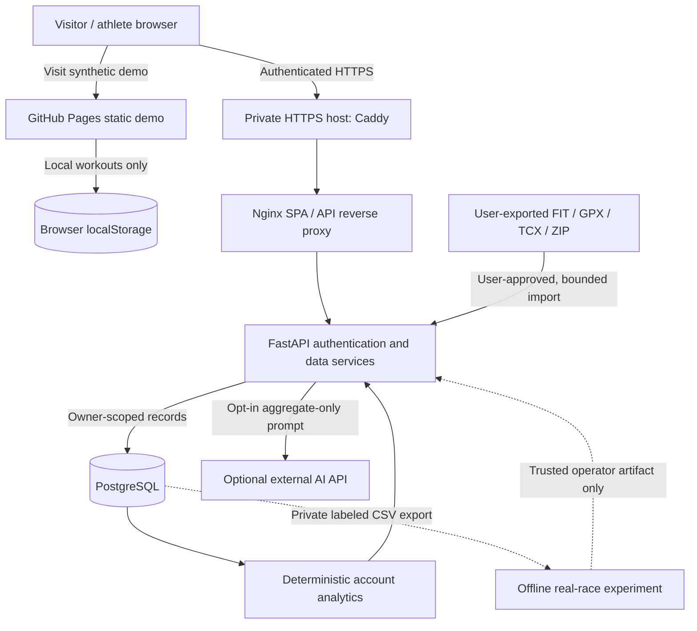

# PaceLab architecture and data flow — v0.7

## System boundary

PaceLab offers two intentionally different products: a **public, synthetic
browser demo** and a **self-hosted, authenticated full-stack service**.
A GitHub Pages site cannot itself run PostgreSQL, a Python API or private
FIT/GPX/TCX server uploads. The live public preview does not imply those
capabilities are hosted.



## Layers

| Layer | Implementation | Responsibility |
|---|---|---|
| UI | HTML, CSS, JavaScript ES modules | Dashboard, race formula, charts, local sample mode |
| Pure analytics | src/core.js, intelligence-core.js, performance.js | Pace/time, week bins, consistency, PR history |
| API client | src/api.js | Account token, authenticated workout requests |
| API | backend/app/main.py and routers | Validation, identity, import, insights and predictions |
| Persistence | SQLAlchemy, PostgreSQL / development SQLite | User-owned workout and sensor records |
| Schema lifecycle | Alembic 0001/0002/0003 | Add account, activity and running-dynamics fields |
| Research | backend/ml | Offline chronological model experiments |
| Operations | Compose, Nginx, Caddy | Local services, HTTPS reference, readiness and backups |

## Data model

### User

- Random primary key and unique normalized email
- Argon2 password hash; **no plaintext passwords are stored**
- Timestamps and relationships to owned workouts

### Workout

- Owner user ID, date, type, duration in integer seconds, distance in miles
- Optional notes, source format, start timestamp and source hash
- Optional average and maximum heart rate, elevation gain/loss, cadence, power
- Session **timer/moving time** and separate **elapsed time** when available
- Device lap JSON and downsampled private track JSON (up to 500 points)

Hashes prevent identical file re-imports; start-time/distance/duration matching
helps detect equivalent files exported in multiple formats. A hash is not
a public athlete identifier and must not replace authentication.

## Data provenance and units

A FIT session may include moving/timer time that differs from wall-clock
elapsed time because of pauses; that distinction must survive upload to
database to browser chart. Recorded device laps can vary in length. Pace
per mile is normalized for comparisons, but is not a substitute for the
original device split. A missing heart-rate, power or elevation field is
**unknown**, not zero. FIT missing-value sentinels are filtered.

Each imported source file is parsed in memory and discarded. Reduced GPS
coordinates are still private data and can reveal a runner's location. Never
place real FIT data into CI fixtures or a public demo.

## Trust and privacy boundaries

1. The visitor's GitHub Pages browser data stays in that browser unless
   the visitor explicitly configures a separate HTTPS backend.
2. Server API requests validate JWT and derive user identity server-side.
   A supplied workout ID is checked against the authenticated owner.
3. Imports enforce content type, bounded bytes and bounded ZIP expansion;
   XML parsing uses defensive parsing to reject entities.
4. The assistant is deterministic by default. Its optional language-model
   integration sends only the question and verified aggregate metrics,
   never raw GPS, notes, authentication headers or the user's email.
5. A trusted locally created model artifact is configured only by an operator.
   Joblib is not a safe format for untrusted uploads.
6. Private backup archives may retain deleted workout records until the
   operator's retention process expires and are encrypted separately.

The existing rate guard is **in-process**, not a distributed anti-abuse
guarantee. Browser bearer tokens do not provide independent server-side
revocation. Public release requires those and the other controls documented
in [SECURITY.md](../SECURITY.md).

## Analysis and scientific interpretation

Training-volume summaries are descriptive. The weighted-minutes chart uses
arbitrary type weights; it is **not** TRIMP, a physiological recovery score,
or a recommendation on injury risk. Heart-rate bands are fixed absolute
buckets, not personally calibrated zones. Race time equivalents use Riegel's
formula and do not claim individualized ML validation.

The optional model export uses **only workouts strictly before each race**.
The offline trainer uses date-grouped train/validation/test partitions and
additional expanding-window tests. See [ML methodology](ml-methodology.md).

## API and deployments

- [API reference](api.md)
- [Self-hosting runbook](../deploy/README.md)
- [Security policy](../SECURITY.md)
- [Tests and CI](testing.md)

### Deployment topology

```text
Public demo:
    GitHub Pages -> index.html, styles.css, src/ -> browser localStorage
Self-hosted private beta:
    Internet HTTPS -> Caddy:443 -> Nginx -> FastAPI -> PostgreSQL
                                                       |
                                       authorized private export/backup
```

The API and database are **not publicly available** on the GitHub Pages demo.


## v0.7 security and cloud boundaries

**Account token generation:** User rows store a numeric `token_version`.
JWTs include the issuing generation and the API checks it against
PostgreSQL on each protected request. Password changes and server sign-out
increment the generation, invalidating all old tokens **across devices**.
This does not yet provide per-device token management, refresh tokens,
verified recovery or HttpOnly cookie storage.

**Browser API audience:** The browser records which API base issued the
session token. Changing the base clears the token rather than forwarding
the previous host's credential elsewhere. Legacy unbound tokens are
intentionally signed out during upgrade.

**Consent points:** An import confirmation is required before uploading
a file that may contain GPS data. Optional LLM processing must be approved
for each question; server provider credentials alone do not authorize data
transmission.

**Managed-cloud option:** The [Render Blueprint](../render.yaml) defines
an opt-in Docker API and managed Postgres service with generated signing
secret, narrow CORS and public registration disabled. Applying it requires
the owner's explicit action, billing review and subsequent verification.
No live API is implied by the YAML file.

See [Render deployment](render-deployment.md) and the
[security release checklist](../SECURITY.md).
