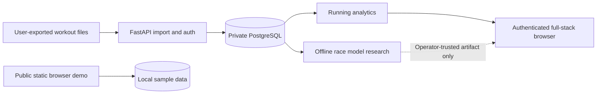

# Engineering case study: PaceLab

## The problem

Runners often have useful training records scattered across their watches,
manual notes and race results. A simple run log does not clearly answer
questions like: How consistent has my mileage been? Is my easy pace changing?
How do two sessions compare? Can I estimate another race distance without
pretending an untested model is reliable?

PaceLab began as a portfolio project at the intersection of **distance
running, software engineering and AI/ML**. Its design goal is to build
something an athlete can explore, while keeping the data-science claims
auditable and sensitive location records private.

## What was built

### Usable public experience

A click-to-open GitHub Pages demo with a guided tour, fictional sample
training, local workout logging, charts, deterministic training explanations
and a formula-based race calculator. Visitors need no Docker installation
or login to explore the product.

**Live demo:** [Try PaceLab](https://dokeefe414.github.io/Pacelab/)

### Full-stack engineering implementation

FastAPI routes, Pydantic input validation, SQLAlchemy/PostgreSQL persistence,
Alembic migrations, Argon2 password storage and scoped authenticated
workout access. User-exported FIT, GPX, TCX and bounded ZIP files can be
parsed and imported into a self-hosted private backend with hashed
duplicate detection.

### Athlete intelligence

- Weekly mileage, training mix and 12-week consistency calendar
- Workout-to-workout comparisons with normalized pace and HR where recorded
- Personal race progression limited to workouts explicitly marked Race
- Device lap, timer versus elapsed, cadence, power and HR/elevation traces
- Deterministic assistant that identifies selected relevant workout records

### AI research infrastructure

Real-labeled pre-race feature export, multiple model families, chronological
and expanding-window evaluation, baseline comparison, interval coverage,
model-card documentation and caveats about distribution shift.

**No trained model's performance on a representative real athlete dataset
is claimed here.** Synthetic CI fixtures test the machinery only.

### Operational quality

Separate backend and browser test suites, negative account-access tests,
readiness checks, private backups and an isolated restore procedure.
The repository contains a provider-independent HTTPS deployment runbook,
but that full service still requires an operator-provisioned server.

## What makes the engineering interesting

**Two trust modes:** The synthetic demo is accessible to everyone, while the
private account mode has separate ownership and authorization.

**Sensor-data semantics:** FIT values may contain missing-value sentinels,
moving time and wall-clock elapsed time, and irregular device laps. Getting
these details right matters more than an attractive but incorrect chart.

**Preventing time-series leakage:** A prediction model must not use workouts
after the race it predicts. The labeled export and chronological evaluation
are designed around that constraint.

**Scientific transparency:** Descriptive training statistics, formula
equivalents and supervised models are presented as different products with
different evidence requirements.

**Maintainability:** Pure functions for the browser, API integration tests,
migrations and a documented deployment topology make the repository
inspectable during technical interviews.

## Architecture overview

## Demonstrate in an interview

1. Open the public demo and explore the mileage dashboard.
2. Log a **fictional workout** and explain local persistence.
3. Compare workouts and show race progression data requirements.
4. Walk through a FIT import test with missing HR, elapsed time and laps.
5. Explain why every private API route derives ownership from the token.
6. Show the chronological ML evaluation and why held-out data matters.
7. Explain why the demo is public but the private full stack is not yet
   presented as a production-secure consumer service.

## Example resume description (adjust to your actual role)

> Developed PaceLab, an open-source running analytics platform with
> FastAPI, PostgreSQL, JavaScript, Docker and Playwright. Implemented
> owner-scoped activity imports, athlete analytics and a leakage-conscious
> race-time modeling experiment with chronological baselines, while
> deploying a no-installation public demo through GitHub Pages.

Do not claim production customers, sports-science accuracy, number of
users or measured prediction improvements unless independently supported.

## Future work

- Operator-hosted HTTPS full stack and public account hardening
- Athlete-disjoint and prospective race data collection with consent
- Better out-of-distribution checks and uncertainty calibration
- Accessibility and mobile usability testing with independent participants
- Responsible COROS provider integration if official access becomes available

See [system design](architecture.md), [ML methodology](ml-methodology.md),
[API reference](api.md) and [deployment runbook](../deploy/README.md).
